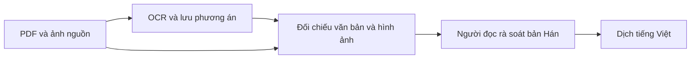

# OCR chữ Hán cổ và dịch tiếng Việt

Dự án chuyển PDF scan sách Hán, đặc biệt sách Y học cổ truyền, thành bản chép
có thể rà soát rồi dịch sang tiếng Việt. Khó khăn chính là nguồn ít pixel, chữ
phồn thể/dị thể, bố cục phức tạp và không có bản chép chuẩn để đối chiếu
(ground truth). Một câu trôi chảy chưa chứng minh chữ đã được nhận dạng đúng.

Notebook 1 tạo bộ ảnh bất biến để người dùng upload thành Kaggle Dataset.
Notebook 3 dùng lại bộ ảnh đó trong phiên mới, giữ raw checkpoint để thay đổi
đánh giá mà không inference lại.

Cách tiếp cận là giữ ảnh gốc, chạy nhiều OCR trên cùng lựa chọn, lưu các phương
án bất đồng và đưa bằng chứng về cho người đọc. Đồng thuận, độ ổn định khi đổi
ảnh và độ phủ không gian giúp tìm chỗ cần xem; chúng không đo accuracy.

## Đọc tài liệu

| Tài liệu | Mục đích |
|---|---|
| [Bài toán và giới hạn](problem.md) | Dữ liệu, mục tiêu và nguyên tắc xử lý sự không chắc chắn. |
| [Pipeline hiện tại](pipeline.md) | Luồng đã có trong mã, hợp đồng dữ liệu và giới hạn bằng chứng. |
| [Giả thuyết nghiên cứu](hypotheses.md) | H01–H10: lý do thử, cách kiểm chứng và điều kiện thất bại. |
| [Vận hành và kiểm chứng](usage.md) | Notebook, runtime, tài sản offline, chạy mẫu nhỏ, checkpoint và xử lý lỗi. |

Mốc đối chiếu tài liệu: **12/11/2026**, nhánh `mduy`. Mã có adapter cho bốn OCR,
chuẩn bị ảnh, consensus, coverage, stability và dịch. Có kiểm thử CPU/dữ liệu
tổng hợp; điều đó không xác nhận inference bốn model trên Kaggle hay chất lượng
OCR của corpus. Phạm vi kiểm chứng cụ thể nằm trong hướng dẫn vận hành.
