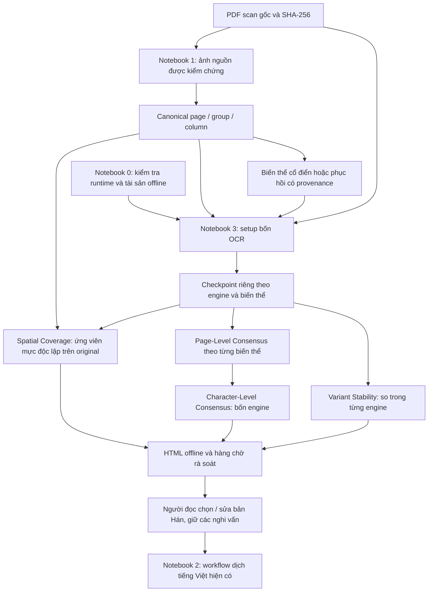

# Pipeline OCR sách Hán và dịch tiếng Việt

Tài liệu vận hành của nhánh `mduy`, cập nhật ngày 11/11/2026. Điểm xuất phát của
lần triển khai coverage/stability: commit `99913518b0992caa95d0955ca5661b406f288c59`,
working tree sạch. Đã đối chiếu bốn notebook, các tài liệu cũ và mã nguồn trước khi sửa.

## 1. Mục tiêu và mức độ bằng chứng

Chuyển PDF scan sách Hán lịch sử thành văn bản OCR có thể truy về pixel nguồn,
sau đó dùng văn bản đã rà soát làm đầu vào dịch tiếng Việt. Giữ chữ phồn thể,
dị thể, số lượng, liều lượng, phủ định, tên dược liệu và mọi phương án còn tranh chấp.
Không tự sửa chữ bằng LLM hoặc tự lấy bản phục hồi làm bản chép chuẩn.

Ba khái niệm cần tách biệt:

| Khái niệm | Hệ thống hiện xác định được gì? |
|---|---|
| Tính đúng của OCR | Chưa đo được vì không có bản chép ground truth. Không có CER/WER hoặc điểm accuracy. |
| Đồng thuận và ổn định | Mức giống/khác giữa engine hoặc giữa các đầu vào của cùng engine. Các model có thể cùng sai. |
| Độ trung thành của bản dịch | Phụ thuộc bản Hán đã chọn và quá trình dịch; các chẩn đoán OCR không đánh giá chất lượng dịch. |

Không huấn luyện, fine-tuning, LoRA, pseudo-label hoặc thêm OCR/VLM mới trong lớp
thu thập bằng chứng. Ngưỡng kỹ thuật không phải xác suất đã hiệu chuẩn.

## 2. Kiến trúc và các notebook



Notebook 1 và notebook 3 là hai workflow chạy **riêng biệt**. Có thể chuẩn bị,
đóng gói và gắn ảnh thành Kaggle Input từ một phiên trước. Notebook 3 cũng giữ
luồng render PDF trực tiếp; không bắt buộc chạy notebook 1 trong cùng phiên.

| Notebook | Đầu vào, nhiệm vụ và đầu ra |
|---|---|
| [0 — kiểm tra môi trường](../0_kiem_tra_moi_truong_kaggle_offline.ipynb) | Kiểm kê Python, package active, ABI, CPU/RAM/GPU và phép thử nhỏ; xuất JSON/TXT. Không cài package, tải model hoặc OCR. Chạy lại khi kernel thay đổi. |
| [1 — chuẩn bị ảnh](../1_chuan_bi_anh_ocr.ipynb) | PDF → canonical, layout, biến thể, manifest, QC và preview. Tự chứa mã; chế độ process chỉ dùng tài sản local. Các adapter neural đã có nhưng mức kiểm chứng khác nhau. |
| [3 — OCR và bằng chứng](../3_so_sanh_so_chu_ocr.ipynb) | Bốn engine tuần tự; checkpoint, đồng thuận cấp trang/ký tự; coverage và multi-variant opt in; HTML/JSONL/crop/ZIP offline. |
| [2 — dịch](../2_dich_han_viet.ipynb) | TXT Hán đã chọn → chia đoạn → model dịch → TXT Việt. Bản hiện có clone/cài repo và tải model Hugging Face; **chưa phải workflow hoàn toàn offline**. |

Coverage và stability đã có triển khai CPU, kiểm thử tổng hợp và tích hợp worker
giả. Chưa có lượt inference bốn model với nhiều biến thể trên Kaggle. Neural
restoration vẫn là thí nghiệm; các hướng xác minh ngữ nghĩa ở mục 9 chưa triển khai.

## 3. Kaggle, local và tài sản cần có

### Bố trí Input

```text
models/
  hunyuan/                 # snapshot HunyuanOCR-1.5
  ppocr_det/               # PP-OCRv6_medium_det
  ppocr_rec/               # PP-OCRv6_medium_rec
  paddle_vl/               # PaddleOCR-VL-1.6
  paddle_layout/
  tonggu/ocr/
  tonggu/layout/finetune_infer.pth
  models_manifest.json
  image_restoration/       # chỉ notebook 1 cần trọng số phục hồi
packages/
  wheels/
  sources/                 # Python portable và source dependency đã giải nén
  requirements/
  paddle_manifest.json
  tonggu_manifest.json
  system_assets_manifest.json
  bundle_manifest.json
  image_restoration/       # package/source riêng cho notebook 1
pdfs/*.pdf
image_dataset/             # tùy chọn; bắt buộc khi OCR nhiều biến thể
  dataset.json
  snapshots/
  objects/
```

Điền `PACKAGES_DIR`, `MODELS_DIR`, `DATA_DIR` ở đầu notebook 3. Có thể có thêm
folder bọc `packages/` hoặc `models/`. Không dùng `Path("")` để biểu diễn đường
dẫn chưa cấu hình. PDF vẫn cần để xác minh SHA-256 và rà soát ảnh nguồn.
`PREPARED_IMAGES` chỉ tới dataset hoặc snapshot cố định. Notebook 3 tiêu thụ ảnh,
không chạy lại Real-ESRGAN/TADiSR/DiffTSR/UniHIR và không cần weights phục hồi.

Upload models, packages, PDF và prepared images là các thao tác thủ công riêng.
Không có upload tự động hoặc download trong lượt OCR offline. ZIP cũ không mặc
nhiên chứa nhánh `image_restoration/` mới. Không gắn chỉ riêng bản vá NCCL hoặc
`sources_upload_test.zip` như một bộ packages đầy đủ.

### Tương thích runtime

Runtime tham chiếu trong báo cáo cũ: Linux x86_64/glibc 2.39, CPython 3.13.16,
CUDA 13.0, GCC 13.3, RTX PRO 6000 Blackwell `sm_120`, khoảng 94,97 GiB VRAM.
Phải kiểm tra lại phiên thực tế; đây không phải cấu hình máy local vừa kiểm thử.

| Thành phần | Cách ly và điều kiện |
|---|---|
| HunyuanOCR-1.5 | Kernel Torch/Transformers đã qua API/NumPy/CUDA probe; revision mặc định `47644ecc4fc854efa4f505155158831f36773ee4`. |
| PP-OCRv6-medium, PaddleOCR-VL-1.6 | Python 3.13 riêng, Paddle GPU 3.2.1, PaddleOCR/PaddleX 3.7.x; wheels CUDA tương ứng bundle. |
| TongGuOCR Stage 3 | Python 3.10 riêng, Torch 2.10.0+cu130, torchvision 0.25.0+cu130, Transformers 5.3.0; OpenMMLab/MMCV được build và probe riêng. |

Bundle OCR tham chiếu khoảng 3,93 GiB, 74 artifact; một số dependency dùng lại từ
kernel sau kiểm tra version, dependency, ABI và RECORD. Không ghép extension
cp313 vào cp310 hoặc hạ Torch/NumPy kernel để giải quyết xung đột. Chỉ một provider
OpenCV trong mỗi runtime. Thay đổi kernel có thể làm bundle này không còn phù hợp.

Source upload là thư mục file thường, không phải archive lồng hoặc symlink.
Installer phục hồi tên Linux/quyền thực thi vào `/tmp`, xác minh hash, sửa prefix
Python portable và build trong bản sao ghi được. Cache `.pyc` thiếu chỉ được bỏ
qua khi nguồn `.py` tương ứng đã được xác minh; thiếu payload thật vẫn dừng.

Installer dùng `pip --no-index --no-deps`, probe compiler/C extension, dependency
closure, NumPy bridge và CUDA; MMCV phải qua `mmcv.ops.nms_rotated` trên GPU.
Cache wheel có danh tính source/Python/NumPy/Torch/CUDA/compiler/cờ build và hash.
Chạy lại Setup có thể dùng component và wheel đã được xác minh trong cùng phiên.
Log người dùng trước đây xác nhận build MMCV, nhưng chưa chứng minh lượt OCR
bốn model sau mọi bản sửa đã thành công trên Kaggle.

`runtime_config.json`, `notebook_setup_receipt.json`, `build_logs/`,
`build_probe/toolchain.json`, `.vtm_kernel_plan.json`, `.vtm_opencv_payload.json`
và `.vtm_opencv_probe.json` là các bằng chứng chẩn đoán. Runtime đặt trong `/tmp`
vì dung lượng working hạn chế; phiên mới cần chuẩn bị lại. Input luôn chỉ đọc.

Local Windows dùng `.venv` gốc, Python 3.13, không thêm Paddle CPU. TongGu cần
WSL/Linux Python riêng qua `ADVANCED['tonggu_repo']`, `tonggu_python`,
`tonggu_wsl_distro`; ánh xạ ổ đĩa `C:` → `/mnt/c`, chưa hỗ trợ UNC. Kernel và
interpreter notebook đều chọn `.venv/Scripts/python.exe`. Máy local 8 GB không
đại diện khả năng chạy TADiSR/UniHIR hoặc GPU Kaggle 96 GB.

## 4. Ảnh nguồn, crop và biến thể

### Canonical và hợp đồng tọa độ

PDF gốc vẫn là nguồn có thẩm quyền. `acquire_pdf_image()` chỉ trích native khi
placement, crop/clip, rotation, annotation và so sánh **toàn pixel** với visible
render đều đạt. Nếu không, PDFium render giữ composition, mask, lớp phủ và hướng
trang. Trang chỉ có raster theo mật độ scan; trang hỗn hợp dùng ít nhất DPI yêu
cầu và mật độ ảnh quan sát được. Vượt `max_source_pixels` thì lỗi, không âm thầm
thu nhỏ. RGB PNG bảo toàn pixel hiển thị được kiểm chứng, không phải bản sao byte
stream nén hay mọi metadata màu của PDF. DPI vật lý chưa xác định nếu có `/UserUnit`.

Phân hoạch `page`, `group`, `column` phủ đủ nguồn, không chồng lặp, không xóa lề.
`column` là vùng hình học ứng viên; có thể chứa nhiều cột chữ thật. `group` gộp
các vùng liền nhau từ phía bắt đầu đọc. Hướng `vertical_rtl`: cột phải → trái,
trong cột trên → dưới; `horizontal_ltr` giữ hướng ngang. Manual cuts là tỷ lệ
ngang tăng dần trong `(0,1)`; `page_column_cuts` dùng số trang từ 1, `[]` giữ nguyên.
Phép chiếu không phải detector ngữ nghĩa: layout luôn cần xem trước đường cắt.

| Trường | Ý nghĩa đã kiểm tra trong mã |
|---|---|
| `page` trong canonical/raw worker | Chỉ số bắt đầu từ 0; báo cáo cho người đọc dùng từ 1. |
| `source_box` | `[x1,y1,x2,y2]`, hộp nửa mở, gốc trái trên, đơn vị pixel ảnh nguồn. |
| `image_to_source` | Sáu hệ số affine `x'=a*x+c*y+e`, `y'=b*x+d*y+f`; hiện các biến thể OCR dùng crop + scale. |
| `source_to_pdf` | Pixel nguồn → canvas PDF, có xét rotation/crop; không tự coi đơn vị là DPI vật lý. |
| `snapshot_id`, SHA-256 | Danh tính descriptor, PDF, metadata/object và pixel RGB; đường dẫn object là tương đối và không thoát root. |

Ảnh phân tích có thể thu nhỏ; canonical/crop không bị giảm theo model. Ở inference
có ba lớp: render cũ `dpi/max_side`, PNG backend `region_max_pixels/region_max_side/
region_upscale`, và processor `model_min_pixels/model_max_pixels`. Tensor Hunyuan
được quan sát qua `image_grid_thw`; native backend ghi rõ khi không thấy tensor nội bộ.
Một ảnh ×4 có thể bị processor thu nhỏ; không suy ra restoration tốt hơn từ độ sắc.

`IMAGE_PREPARATION` giữ tách vùng `auto`, grouping, ngân sách và `resolution_strict`.
Native Paddle/TongGu giữ layout riêng khi không ép crop chung. Nếu không tìm được
khe đáng tin cậy, giữ vùng rồi ghi resize/cảnh báo; strict làm trang lỗi thay vì chấp
nhận thu nhỏ. Tất cả model nên dùng cùng canonical crop để so biến thể có kiểm soát.
`native` gửi cả trang; layout bên trong vẫn có thể khác giữa engine/biến thể.

Các profile nhúng còn giữ DPI/cap của `1`:225/750, `2–3`:226/754,
`4–5`:181/704, `6`:226/653, `bien`:200/2333, `kinh`:45/2206.
Đây là điểm xuất phát hình học, không phải cấu hình tối ưu OCR đã đo. Scan 1–6
chỉ khoảng 600–700 pixel; tăng DPI không tạo lại nét đã mất.

### Hai schema ảnh

`vtm-image-dataset` v1 chứa source/acquisition/layout, page records và
`regions.images` với `original`, có thể thêm CLAHE/bicubic ×2 ở builder core.
Notebook 1 mới giữ core original và ghi phục hồi vào **extension riêng**:

```text
dataset.restoration                         # format/version/report reference
  → restoration_manifests/<hash>.json        # vtm-image-restoration v1
      canonical_snapshot                    # core descriptor chưa thêm extension
      manifest → <hash>.jsonl                # mỗi book/page/region/variant có state
          image                             # object reference + image_to_source
          operation, model_identity, qc, extras, provenance
```

Reader notebook 3 kiểm tra version, hash descriptor/snapshot/report/manifest,
canonical identity, danh sách vùng và trạng thái, PDF nguồn, crop/order, provenance,
kích thước, pixel, scale và affine của ảnh được tiêu thụ. Các trạng thái `failed`,
`missing_assets`, `not_applicable`, `skipped_by_configuration`, `missing_variant`
được giữ rõ. Một vùng thiếu làm cả trang/biến thể không chạy; không lưu văn bản
đầu trang thành kết quả hoàn chỉnh. Dữ liệu hỏng báo lỗi; không thay bằng original.
Việc thêm extension không sửa core hoặc snapshot cũ.

| Biến thể | Vai trò và giới hạn |
|---|---|
| `original` | `source_observation`, đối chứng mặc định, giữ pixel nguồn. |
| `clahe`, `denoised` | `deterministic_transformation`, scale 1; tăng tương phản/NLM có thể làm mất nét yếu. |
| `bicubic_x2`, `bicubic_x4` | Nội suy deterministic, affine 0,5/0,25; không phục hồi chi tiết có thật. |
| `realesrgan_x4`, `tadisr_x4` | `neural_restoration`, scale 4; có thể thêm/bớt/gộp nét. Notebook 3 chỉ đọc ảnh đã sinh. |
| `tadisr_text_mask` | Diagnostic do model sinh; bị từ chối làm ảnh OCR hoặc bằng chứng nguồn độc lập. |
| `difftsr` | Chỉ với `ALLOW_GENERATED_VARIANTS=True` và metadata đã duyệt: dòng ngang thẳng, 1–24 chữ, gần tỷ lệ 4:1, cho phép prior giản thể upstream; output 512×128. Không xoay/reflow cột dọc hoặc coi text prior là bản chép. |
| `unihir_restoration` | `generative_reconstruction`, opt in riêng và vùng inscription/điều kiện giấy phép đã khai báo. Mapping chỉ canvas danh nghĩa; không dùng geometry của glyph sinh ra làm bằng chứng nguồn. |

Ảnh ngoài hợp đồng hiện tại như deskew/dewarp chưa có mapping được kiểm chứng nên
không nhận như biến thể OCR hợp lệ. Không chạy restoration nặng trong notebook 3.

### Trạng thái và giấy phép restoration

Notebook 1 có classical, Real-ESRGAN tiled, TADiSR kèm mask, adapter DiffTSR và
UniHIR. TADiSR xử lý độc lập hai trục tile và kiểm phủ đủ crop hẹp/dài. Preflight,
pixel/storage budget, timeout vùng, model-load timeout, seed, cache và trạng thái
partial đều riêng; mặc định không công bố dataset thiếu khi chưa bật partial.

Artifact cũ ghi Real-ESRGAN đã inference local trên `4/p50`; lần này chỉ xác minh
lại ảnh/mapping đã lưu. TADiSR có base/adapter nhưng chưa có inference được xác nhận;
DiffTSR chưa có input/runtime phù hợp được kiểm chứng; UniHIR còn thiếu checkpoint
chính trong bàn giao cũ. Không coi inventory cũ là xác nhận asset hiện còn đầy đủ.

| Nguồn | Điều kiện cần giữ |
|---|---|
| Real-ESRGAN / BasicSR | BSD-3-Clause / Apache-2.0; RRDBNet 64/23/32, weights ×4plus. |
| TADiSR / CogView4 | Code MIT, adapter phạm vi research, base Apache-2.0. Adapter SHA-256 `7cec8d0917305037cbafcb1b1bf81062add1613b561f5d7e2d1e599fe0baf5e0`. |
| DiffTSR | Apache-2.0; giữ cảnh báo prior `zhconv(...,'zh-cn')`, không thay chữ phồn thể nguồn bằng prior. |
| UniHIR | CC BY-NC-ND 4.0, nghiên cứu phi thương mại; source nhúng nguyên trạng, wrapper riêng. Quyền phân phối lại các font chưa được xác lập từ metadata tác giả đơn thuần. |

Các license, revision, URL và checksum cụ thể nằm trong `assets.json` và manifest
tài sản. OCR weights, upstream code và PDF cũng có điều kiện riêng; không suy
license của toàn bộ asset từ license wrapper. Không đưa binary hoặc font vào Git.

Kiểm kê SHA-256 ngày 11/11/2026 xác nhận 53 file model OCR, các asset đã ghi của
Real-ESRGAN/TADiSR/DiffTSR/UniHIR, 5972 payload packages OCR và 13 wheel TADiSR
đều khớp manifest local. Kiểm tra lại sau khi tải xong: checkpoint chính UniHIR
29.302.764.504 byte đã đủ và khớp SHA-256 upstream. Tổng 6.090 file được kiểm
hash, khoảng 74,76 GiB; không còn file `.part` hoặc dependency thiếu theo báo cáo
Kaggle đã cung cấp. Báo cáo mới: `work/offline_assets_latest_audit.json`.
Không cần tải checkpoint này cho classical, Real-ESRGAN, TADiSR hoặc notebook 3.
Nếu cần thử riêng UniHIR, script sau chỉ tải khi có `--download`:

```powershell
.venv/Scripts/python.exe -X utf8 tools/download_unihir_checkpoint.py
.venv/Scripts/python.exe -X utf8 tools/download_unihir_checkpoint.py --download --accept-unihir-noncommercial
```

Nếu tải một kết nối chỉ khoảng 1 MiB/s, dừng tiến trình cũ bằng `Ctrl+C`, chờ nó
dừng hẳn rồi tiếp tục với bốn kết nối:

```powershell
.venv/Scripts/python.exe -X utf8 tools/download_unihir_checkpoint.py --download --accept-unihir-noncommercial --connections 4
```

Không xóa `.part` hoặc file receipt. Các worker chỉ đọc những HTTP Range giới hạn
8 MiB; một writer ghép đúng thứ tự vào phần đã tải liên tục. File cuối vẫn phải
khớp đủ kích thước/SHA-256 trước khi công bố. Ngắt giữa chừng có thể phải tải lại
các đoạn chưa ghép, không mất phần đã ghi. Script giữ khóa để tránh hai lượt tải
cùng ghi một file. Tùy chọn nhận 1–8 kết nối, mặc định vẫn là 1.

Đo nhỏ từ máy này: bốn kết nối đạt khoảng 3,0 MiB/s, một kết nối 1,13 MiB/s;
đây không phải cam kết tốc độ cho cả file. README upstream hiện chỉ liên kết
ModelScope; tìm trên Hugging Face chưa có model UniHIR công khai và endpoint
ModelScope `.ai` trả 404 cho model này. API `.cn` và URL resolve đều về cùng CDN.

Script dùng URL/revision/SHA-256 cố định, resume `.part` khi HTTP Range hợp lệ,
kiểm đủ byte/hash rồi mới công bố file và cập nhật `assets.json` cùng manifest
trạng thái liên quan. Ngắt thì chạy lại cùng lệnh; file sai được giữ để kiểm tra.
Không tải lại base TADiSR, cài package, sửa kernel hoặc upload. Runtime DiffTSR/
UniHIR vẫn cần kiểm chứng riêng; tải đủ weights không thay điều kiện này.

### Bổ sung theo báo cáo Kaggle ngày 11/11/2026

Báo cáo thực tế xác nhận Python 3.13.16, Torch 2.11.0+cu130, CUDA toolkit 13,
GPU RTX PRO 6000 Blackwell sm_120 khoảng 95 GiB, NumPy/OpenCV và các API
restoration cơ bản chạy được. Probe DiffTSR thiếu `zhconv`; kernel thiếu
`flash-attn`. Báo cáo không thấy `models/`, `packages/`, `prepared/`: notebook 0
chưa gắn Dataset dự án, nên chưa kiểm được asset đã upload hoặc private runtime.

Đã bổ sung vào `kaggle_upload/packages/image_restoration/` tám wheel còn thiếu
và source FlashAttention 2.8.3.post2 có đủ CUTLASS. Tổng hiện có 21 wheel
restoration; TADiSR vẫn dùng bộ 13 wheel riêng. Bộ DiffTSR dùng các dependency
linear attention đời tương ứng; UniHIR dùng Transformers 4.49.0 theo upstream,
không dùng Transformers 5 của kernel. Ba bộ restoration và hai bộ OCR không còn
dependency thiếu khi đối chiếu metadata với báo cáo này. Kiểm metadata không
thay thế cài đặt, kiểm ABI/RECORD, biên dịch native hoặc inference trên Kaggle.

Script bổ sung có thể chạy lại; mặc định chỉ in kế hoạch:

```powershell
.venv/Scripts/python.exe -X utf8 tools/prepare_kaggle_offline.py
.venv/Scripts/python.exe -X utf8 tools/prepare_kaggle_offline.py --download-small
```

Mọi file tải về nằm đúng thư mục `kaggle_upload/`; script kiểm SHA-256 PyPI,
chọn wheel Linux x86_64/cp313, build ba wheel Python thuần từ source đã kiểm hash,
và ghi manifest. Không cài package vào `.venv`. Script hoãn mọi lượt tải **trên
5 GB hoặc ước tính quá 300 giây** (mặc định 1 MB/s), không tự tải checkpoint
UniHIR 29,3 GB. Dùng lệnh `download_unihir_checkpoint.py` phía trên cho file đó;
file `.part` hiện có được tiếp tục khi chạy lại, không cần xóa hoặc tải lại từ đầu.

Notebook 1 đã dùng bộ cài runtime này tự động khi chọn DiffTSR/UniHIR và để
`RUNTIME_PYTHONS={}`. Mỗi model có venv overlay riêng, kế thừa Torch đang hoạt động.
UniHIR cần biên dịch FlashAttention bằng CUDA/GCC trên Kaggle, chỉ cho kiến trúc
GPU hiện tại, hoàn toàn từ source local; lần đầu có thể mất nhiều thời gian.
Log nằm dưới `/tmp/vtm_image_runtime/environments/.../native_build/build.log`.
Chỉ cache runtime sau khi kiểm tra import/native operation; worker của notebook
vẫn probe riêng trước khi nạp weights. Chưa có build hoặc inference này được
thực hiện trong phiên chuẩn bị trên Windows.

Cập nhật Dataset **packages** từ thư mục hiện tại; sau khi tải UniHIR xong,
cập nhật cả **models** cùng manifest tải tương ứng trong packages. Dùng notebook 1
đã sửa trong workspace, gắn đúng các Dataset này; không cần tải lại model đã đủ.
ZIP cũ không được tái tạo tự động. Báo cáo chi tiết nằm ở
`packages/image_restoration/manifests/offline_completion.json` và
`ocr_report_compatibility.json`.

Kiểm tra mạng local không thấy QoS throttle, proxy hay driver giới hạn tốc độ;
Lenovo Network Boost đang `off`, TCP autotuning là `normal`. Probe giới hạn
8 MiB mỗi nguồn đạt Cloudflare 6,77 MB/s, Hugging Face 2,41 MB/s, ModelScope
0,85 MB/s. Đây là phép đo ngắn, cho thấy máy không bị trần chung 1 MB/s;
chưa xác định được nút thắt ở CDN hay tuyến mạng. Không sửa registry hoặc dịch vụ
vì chưa tìm thấy giới hạn cụ thể cần gỡ. Bằng chứng và phạm vi kiểm tra nằm ở
`work/network_bandwidth_audit.json`; router/ISP và hai nhánh registry tài khoản
dịch vụ bị từ chối truy cập không được kiểm tra.

## 5. Cách chạy từ mẫu nhỏ

### Baseline một sách, một trang

Trong ô cấu hình notebook 3, điền ba đường dẫn Input rồi:

```python
BOOKS = ["1"]
MAX_BOOKS = 1
PAGES = "1"
LIMIT = 1
RUN_OCR = True
PREPARED_IMAGES = ""
PREPARED_VARIANT = "original"
ENABLE_MULTI_VARIANT_OCR = False
ENABLE_SPATIAL_COVERAGE = False
```

Run All chạy setup → worker → bốn stage → so sánh → xuất. Mặc định sẵn trong
notebook vẫn giữ toàn bộ một PDF (`PAGES=""`, `LIMIT=None`) để tương thích;
hãy đổi thành mẫu trên trước lượt dài. `RUN_OCR=False` không nạp model.

`BOOKS` nhận tên/stem/glob, `MAX_BOOKS` giới hạn PDF sau lọc. `PAGES` từ 1 cho
từng PDF, ví dụ `"2,50"`; `LIMIT` giới hạn **tổng** trang sau chọn trên mọi PDF.
Đổi phạm vi sách/trang không tự xóa output đã xong cùng nguồn/cấu hình.

### Dataset chuẩn bị và multi-variant

Chuẩn bị bằng notebook 1 ở phiên riêng, giữ smoke `BOOKS=['1']`, `PAGES='1'`,
`LIMIT=1`, `MAX_BOOKS=1`, chọn ít biến thể. Xem preview/QC rồi gắn output dưới
dạng Dataset vào notebook 3. Chỉ single-variant cũng dùng được:

```python
PREPARED_IMAGES = "/kaggle/input/YOUR_IMAGES"  # có dataset.json
PREPARED_VARIANT = "original"
PREPARED_CROP_TYPE = "group"  # page | group | column | native
PREPARED_MISSING_FALLBACK = False
```

Để so ảnh gốc với nội suy ×4 đã có trong extension:

```python
ENABLE_MULTI_VARIANT_OCR = True
OCR_VARIANTS = ["original", "bicubic_x4"]
ALLOW_GENERATED_VARIANTS = False
VARIANT_STABILITY_OPTIONS = {
    "reference_variant": "original",
    "compare_by_engine": True,
    "compare_across_engines": True,
    "save_difference_crops": True,
}
```

Multi-variant bắt buộc có prepared images và không bật missing fallback. Phải
có `original` trong danh sách; reference cũng phải được chọn rõ. Tên sai/mask bị
từ chối. Biến thể chưa chuẩn bị giữ trạng thái thiếu, không làm kết quả giả.
Các tổ hợp thiếu không bỏ phiếu; worker dùng một model cho tất cả trang/biến thể
hợp lệ rồi thoát trước engine tiếp theo. Không giữ bốn model lớn cùng lúc.

### Coverage và đọc lại checkpoint

```python
ENABLE_SPATIAL_COVERAGE = True
SPATIAL_COVERAGE_OPTIONS = {
    "analysis_max_side": 1600,
    "save_overlays": True,
    "save_candidate_masks": False,
    "max_detail_crops": 12,
}
```

Coverage cũng chạy trên luồng PDF trực tiếp hoặc log cũ nếu nguồn được xác minh.
Khi không có geometry đáng tin cậy, báo chưa kiểm chứng định vị. Không cần chạy
lại model chỉ để phân tích coverage.

Đọc lại run tại `WORK_DIR`: đặt `RUN_OCR=False`, để `EXPORTED_LOG_DIR=""` và giữ
`ENABLE_MULTI_VARIANT_OCR` đúng loại campaign đã chạy. Multi dùng
`multi_variant_manifest.json`; single dùng `manifest.json`. `ADVANCED['existing_manifest']`
cho phép chỉ tới manifest khác. Danh sách biến thể trong **campaign đã lưu** là
danh sách được phân tích; không ngầm thêm biến thể chưa từng chạy.

Với gói log cũ: `RUN_OCR=False`, `EXPORTED_LOG_DIR='data/log_notebook_3'`,
`DATA_DIR='data'`, `PAGES='2'`, `LIMIT=1`. Import tạo checkpoint riêng dưới working,
không sửa log/PDF. `EXPORT_RESULTS=True` để tạo lại báo cáo.

Smoke CPU đã thực thi, chỉ dùng log/ảnh có sẵn:

```powershell
.venv/Scripts/python.exe -X utf8 tools/smoke_evidence_pipeline.py --logs data/log_notebook_3 --data-dir data --book 1 --page 2 --output work/my_new_evidence_smoke --prepared-dataset work/offline_image_smoke
```

Đối số prepared probe là tùy chọn, cần thư mục thật của người dùng. Lệnh từ chối
ghi đè thư mục output đã có; không inference/download. Ví dụ baseline/multi phía
trên đã được kiểm thử bằng worker giả, chưa được xác nhận bằng bốn OCR trên Kaggle.

### Chạy rộng và thiết lập ít dùng

Sau khi xem mẫu: `BOOKS=[]`, `MAX_BOOKS=None`, `PAGES=""`, `LIMIT=None` chọn toàn
corpus. Đây là cấu hình được hỗ trợ, không phải một lượt đã thực thi trong lần này.
Giữ ít biến thể trước khi mở rộng vì chi phí gần theo số tổ hợp engine × ảnh.

`ADVANCED['ocr']` điều chỉnh cấu hình chung; `model_overrides` chỉnh từng engine;
profile sách ưu tiên DPI/hướng đọc và tham số trong profile. Đặt
`use_book_profiles=False` khi muốn dùng hoàn toàn cấu hình thủ công. TongGu mặc
định timeout 1800 giây/trang; ba engine còn lại 600. Token cap tính theo lần đọc
vùng/block; một vùng lỗi làm cả trang không hoàn tất.

Local CLI core vẫn có `vtm images prepare`, `validate`, `package` và `vtm ocr`.
Packager core chỉ đóng snapshot canonical; **không dùng nó để đóng extension
restoration**. Khi chuyển dataset notebook 1 phải giữ toàn bộ object/report/
manifest/snapshot được tham chiếu. Không sửa Input hoặc snapshot để bỏ qua lỗi QC.

## 6. Đọc đồng thuận, coverage và stability

### Văn bản và đồng thuận

Raw từng engine giữ nguyên. Chuỗi so sánh loại khoảng trắng và markup theo
adapter hiện có, không đổi phồn thể thành giản thể. PP-OCR có thể được xếp lại
cột RTL trên một bản sao; offset và geometry đổi cùng nhau, raw vẫn giữ luồng gốc.

Page-Level Consensus tìm mốc chữ duy nhất, đối chiếu số bản khớp, thiếu/lặp/dư
vùng và đảo thứ tự. Mốc hai đầu giúp tránh gọi một đoạn thay thế là đoạn dư.
Vùng chỉ có text không được gán khung cột. Các nhãn chính:
`suspected_missing_region`, `suspected_duplicate_region`, `suspected_reading_order`,
`suspected_extra_region`, `region_text_mismatch`, `unmatched_region_text`.
Hòa hoặc không đủ mốc giữ chưa xác định. Cả bốn cùng bỏ sót không thể được phát
hiện chỉ từ lớp mốc text này.

Character-Level Consensus dùng Levenshtein/star alignment; PP-OCR là neo khi
phù hợp, không phải đáp án. Đa số nghiêm ngặt vẫn cần **3/4 engine cấu hình**.
Hai–hai hoặc hai–một–một không tự chọn chữ. `None` là thiếu output; `∅` là gap
trong output có thật. Output token-limit, lặp bất thường hoặc vấn đề cấu trúc
đủ đối chứng có thể bị loại khỏi phiếu, nhưng không bị xóa và không hạ mẫu số.

Ngân sách mặc định: căn chỉnh 8 triệu ô; page anchors 4 chữ, tối đa 10 mốc/vùng,
vùng ít nhất 12 chữ, đơn vị tối đa 80 chữ, 20000 chữ/model, 256 vùng, 8 lần xuất
hiện/mốc và 64 mốc toàn trang. Vượt giới hạn giữ `analysis_limit`, không kết luận
từ phân tích thiếu. Có thể chỉnh `ADVANCED['page_consensus_options']` và
`max_alignment_cells`. Model liên quan họ Paddle có thể có lỗi tương quan.

Khung PP-OCR chỉ giữ word box có đúng một ký tự. Chữ khác model được liên kết
bằng căn chỉnh; chữ lặp/đảo đoạn có thể làm liên kết mơ hồ. Khung dòng/khối chỉ
là ngữ cảnh. Không chia đều một dòng để bịa khung chữ của VLM.

### Spatial Coverage độc lập

`generate_visual_candidates()` chỉ nhận ảnh, hướng đọc và tham số, **không nhận
OCR text/box**. Nền cục bộ Gaussian ở hai scale, residual có ngưỡng tương phản
tuyệt đối và adaptive threshold tạo mask mực. Morphology giảm đường kẻ dài,
nối nét gãy nhỏ; connected components lọc kích thước/hình dạng, rồi nhóm theo
hướng dọc/ngang. Mật độ, số component, khoảng cách và mép trang quyết định mức
không chắc chắn. Không coi mọi đốm đen là chữ. Canonical layout chỉ cung cấp
hướng đọc; không lấy OCR boxes làm vị trí ứng viên hoặc dùng mask TADiSR thay nguồn.

Sau bước đó mới raster hóa geometry thật của OCR vào cùng lưới phân tích nguồn.
Crop/upscale/resize được đổi về pixel nguồn; polygon không hợp lệ hoặc nguồn
không khớp bị loại. Character, line, block được phân biệt. Paddle có transform
native chưa xác minh sẽ không được coi là geometry nguồn. TongGu nhận geometry
coarse khi block được nối với nhận dạng bằng `block_id`; raw cũ thiếu liên kết
này vẫn có giới hạn định vị. UniHIR canvas không chứng minh vị trí glyph quan sát.

| Kết quả | Cách hiểu |
|---|---|
| `potential_uncovered_text_region` | Có ứng viên ảnh, ít overlap với geometry đo được; nghi thiếu, chưa phải kết luận OCR bỏ chữ. |
| `partially_covered_region` | Chỉ một phần mực ứng viên nằm trong vùng OCR. |
| `covered_by_character_evidence` | Overlap với khung ký tự ước lượng đạt ngưỡng; không xác nhận đọc đúng. |
| `covered_by_coarse_ocr_region` | Overlap chủ yếu qua khung dòng/khối; không chứng minh mọi chữ bên trong được đọc. |
| `ambiguous_visual_candidate` | Ít mực, ít component, mật độ/spacing bất thường, sát mép hoặc có thể là phi văn bản. |
| `geometry_unavailable` | Không có geometry dùng được; text-only không phải phiếu phủ định vùng chữ. |
| `source_geometry_mismatch`, `analysis_incomplete` | Cần sửa nguồn/mapping hoặc tăng giới hạn; không diễn giải thành bỏ sót đã chứng minh. |

`candidate_ink_overlap_ratio` = số pixel mực trong hợp các hộp ứng viên nằm trong
hợp polygon OCR / tổng pixel mực trong hợp hộp ứng viên. Pixel ở lưới phân tích
giới hạn, không phải đếm chữ. Khi không có geometry hoặc không có mực ứng viên,
giá trị là `null`. Có tỷ lệ character riêng; khung coarse không nâng thành
character coverage. Tóm tắt corpus chỉ cộng các trang có geometry dùng được,
công khai mẫu số và việc scale phân tích có thể khác giữa trang.

Giới hạn mặc định: cạnh phân tích 1600, tối đa 30000 component, 256 ứng viên,
12 crop; residual tối thiểu 10, adaptive window 31, ít nhất 3 component và 40
pixel mực, mật độ 0,08–0,70, vùng mép 2,5% giữ không chắc chắn. Overlap 0,85 là
mức phủ, 0,10 là mức một phần. Các ngưỡng chỉnh được trong `SPATIAL_COVERAGE_OPTIONS`;
đây là heuristic bảo thủ, chưa có precision/recall theo ground truth.

### Variant Stability

So cùng engine/source region với `original` mặc định. Giữ cả text tham chiếu và
text biến thể; chỉ bỏ whitespace, không bỏ khác biệt chữ lịch sử. Đếm exact
agreement, normalized edit distance, thay/chèn/xóa khi căn chỉnh đủ tin cậy.
Gap ở chữ lặp, đảo mốc duy nhất và đoạn thay đổi dài giữ `ambiguous_alignment`;
không xuất offset ký tự giả chính xác. Vượt ngân sách giữ `analysis_incomplete`.
Các số đếm thao tác không duy nhất sẽ để `null`; edit distance vẫn là khoảng cách
chuỗi, không phải CER với bản đúng.

Ví dụ khái niệm: ảnh gốc mờ được đọc là `未`, sau nội suy hoặc SR thành `末`.
Báo cáo giữ hai chữ và crop nguồn/biến thể nếu cùng canonical region; ghi thay
đổi gắn với phép xử lý, không khẳng định SR tạo nét sai hoặc tự chọn chữ nào đúng.

Ma trận engine × variant hiển thị text, trạng thái, kích thước prepared → worker
→ processor, token cap và geometry. Kích thước processor chưa thấy là `null`.
Khác pixel budget được ghi là confound; không coi so sánh đó đã cô lập tác dụng
restoration. Khung crop chung không đồng nghĩa glyph đã align pixel với nhau.

Các dấu hiệu gồm đọc đổi sau transformation, text xuất hiện/biến mất, geometry
biến mất, một reading chỉ có ở một biến thể, original đồng thuận nhưng biến thể
thay đổi, và reading ổn định nhưng chưa xác minh. Không có semantic LLM sửa chữ.
`compare_across_engines` điều khiển đưa đồng thuận từng biến thể vào kết quả;
không gộp biến thể thành phiếu. Bốn engine × năm biến thể vẫn là bốn engine cho
**mỗi** phép đồng thuận, không phải hai mươi người bỏ phiếu độc lập.

`VARIANT_STABILITY_OPTIONS` còn có `max_alignment_cells=8_000_000`,
`max_text_chars=20000`, `max_regions=256`, `max_changes=256`,
`max_difference_crops=12`. Giới hạn thay đổi/crop được ghi rõ; toàn văn raw còn nguyên.

## 7. Lưu trữ, checkpoint và báo cáo

```text
image_dataset/
  dataset.json, snapshots/<hash>.json
  manifests/<hash>.jsonl, pages/<hash>.json
  sources/, layouts/, variants/
  objects/<prefix>/<sha256>.png
  restoration_manifests/, restoration_cache/   # extension notebook 1
WORK_DIR/
  manifest.json                              # campaign original/single
  multi_variant_manifest.json                # thêm khi multi opt in
  runs/ocr_<name>_<config>_<source>/
    run_manifest.json, tasks.jsonl
    ocr_raw/<book>/<name>_shard0.jsonl
    ocr_raw/<book>/<name>_errors.jsonl
    txt/<book>.txt
  variant_runs/<variant>/                    # checkpoint các biến thể khác
  render_cache/, evidence/, *_notebook.log
  output/<book>/
    index.html, pages/p00001.html, style.css, reader.js
    raw/<engine>.jsonl, comparison.jsonl, errors.jsonl, manifest.json
    variants/<variant>/<engine>.jsonl         # raw biến thể bổ sung
    crops/, evidence/                        # ảnh lossless và SHA-256
  output/<book>_results.zip
```

Ảnh lưu theo nội dung để loại trùng; JSON chỉ giữ reference/hash, không nhúng
base64 ảnh. `source → crop → variant → engine → raw → finding` giữ liên kết qua
source SHA, canonical region ID, snapshot, biến thể, cấu hình và hash ảnh.
Schema mới: `vtm-multi-variant-campaign-v1`, `vtm-spatial-coverage-v1`,
`vtm-variant-stability-v1`, `evidence_schema='vtm-evidence-v1'`. Export cũ
`vtm-ocr-book-v1` và các trường cũ giữ nguyên; trường evidence chỉ thêm khi bật.

Checkpoint không ảnh chuẩn bị giữ hash cũ. Original/core single vẫn gắn snapshot
theo hợp đồng trước đây. Restoration có thêm `image_content_key`: chỉ source,
crop, thứ tự và tài sản của biến thể đó, không gồm danh sách biến thể thí nghiệm
khác. Model/revision, prompt, token/decoding, preprocessing và pixel budgets vẫn
tham gia config identity. Đổi `OCR_VARIANTS` không làm mất run hợp lệ của biến
thể khác. Thay source, pixel, restoration identity hoặc cấu hình liên quan sẽ
tách run. Core snapshot mới vẫn có thể tách run original theo quy tắc bảo thủ cũ.

Mỗi trang ghi JSONL/fsync; đuôi ghi dở được giữ riêng trước khi sửa append.
Trang lỗi không giả thành prediction. Restart trong cùng attempt bỏ trang vừa
lỗi để tránh lặp timeout vô hạn; lượt chạy notebook mới thử lại trang thiếu.
Windows dùng timer/hard exit 124 và supervisor restart; Unix dùng alarm. Giữ
`WORK_DIR`, checkpoint và cùng config để resume. Phiên Kaggle mới cần đưa output
cũ vào working ghi được; không chạy resume ghi vào Input.

Mở `index.html` sau giải nén để đọc offline. Mỗi sách có danh sách trang/lọc trạng
thái; trang có bốn tab OCR, đồng thuận, coverage và stability. Ảnh lazy-loaded,
lọc engine/variant/region/loại dấu hiệu trong stability. Màu xanh dương: ứng viên
ảnh gốc; xanh ngọc: OCR geometry; đỏ: nghi chưa phủ; cam: chưa chắc chắn. Crop
stability là ngữ cảnh canonical, không được gọi là alignment glyph.

`status=complete` chỉ có nghĩa đủ output đã chọn; vẫn có thể có quality review,
alignment mơ hồ hoặc phân tích coverage chưa xong. `comparison.jsonl` giữ các
lớp bằng chứng tách biệt, trạng thái thiếu và các phương án chữ. Manifest ghi
tóm tắt corpus, cấu hình và provenance. Không tự chuyển chữ tranh chấp sang dịch.

## 8. Kiểm chứng và cách mở rộng mã

Mã có thẩm quyền ở `src/vtm_corpus/`. Builder AST nhúng cùng hàm vào notebook
và một worker độc lập; không cần import `vtm_corpus` hay checkout trên Kaggle.
Công cụ build và các test cần cho thay đổi này đã được bỏ khỏi quy tắc ignore;
binary, dữ liệu và kết quả vẫn ngoài Git. Sau khi sửa nguồn:

```powershell
.venv/Scripts/python.exe -X utf8 tools/update_kaggle_notebook_bootstrap.py
.venv/Scripts/python.exe -X utf8 -m unittest discover -s tests -q
```

Không sửa notebook 1/2 cho tính năng này. Notebook 3 chỉ bổ sung lựa chọn và các
hàm tiêu thụ/so sánh; giữ offline setup, timeout, exports và đồng thuận hiện có.
Các test CPU cần Pillow/PDFium/NumPy/OpenCV; test notebook cần IPython, bảng cần
pandas. Dùng provider OpenCV phù hợp runtime đã có, không cài chồng nhiều provider.

Bằng chứng local của lượt triển khai này:

- Bộ hồi quy local: **312 test, 311 đạt, 1 bỏ qua** (nhánh Unix alarm trên Windows),
  95,589 giây. Bản sao chỉ chứa các file bàn giao chạy **131 test, đều đạt**,
  46,848 giây, và sinh lại notebook cho byte giống nhau khi không có thư mục
  phát triển bị ignore. Có **33 test mới** kiểm tra mask, cột cùng bị bỏ, text-only, coarse geometry,
  nguồn/mapping ×2/×4 và page/group/column/native, extension/state/hash, resume,
  model load reuse, model × variant lỗi, thống kê phiếu và export offline.
- Worker sinh từ notebook đã chạy trong subprocess chặn import repo, đọc nhiều
  biến thể và resume bằng backend giả. Không phải inference OCR thật.
- Smoke đọc log PDF 1 trang 2, xác minh nguồn, tạo coverage/HTML/crop/ZIP; loader
  đọc pixel/mapping original, CLAHE, ×2, ×4, denoised, Real-ESRGAN của PDF 4 trang
  50 đã có. Không gọi model phục hồi/OCR mới, không sửa dataset nguồn.
  Artifact cuối ở `work/evidence_delivery_smoke_20261111/`: 177 ứng viên, 169
  vùng cần rà soát vì geometry/coarse hoặc hình ảnh không chắc chắn; không có
  vùng đạt điều kiện nghi chưa phủ mạnh ở trang này. Đây không phải xác nhận
  OCR đầy đủ. Tình huống cùng bỏ một cột được chứng minh bằng fixture tổng hợp.
- Đã xem overlay ảnh và kiểm tra link/ảnh/hash/ZIP. Không có browser kết nối
  trong phiên này nên chưa QA tương tác HTML bằng trình duyệt.
- Chưa chạy OCR mới bốn model, chưa chạy multi-variant trên GPU/Kaggle, chưa
  upload và chưa xử lý toàn corpus. Không có kết luận restoration tăng accuracy.

Tài liệu cũ ghi phép thử chuẩn bị 12 trang và quan sát tensor Hunyuan CPU;
đó là bằng chứng lịch sử, không thay một lượt inference hiện tại. Các con số
thời gian/VRAM cũ không được ngoại suy sang RTX PRO 6000. Một smoke một trang
không xác nhận detector hoạt động tốt trên mọi trang chữ cổ, chú thích hoặc hình.

## 9. Giới hạn và hướng tiếp theo

Nguồn ít pixel, mực yếu, cột dính, trang trí và ảnh có thể làm detector classical
bỏ ứng viên hoặc tạo ứng viên giả. Mép giấy, texture và nét gãy được giữ là không
chắc chắn khi không đủ bằng chứng. Coverage không thể xác nhận chữ cụ thể và
không chứng minh đầy đủ bản chép. Các backend thiếu geometry không tạo phiếu
phủ định; khung block rộng có thể che một bỏ sót bên trong.

Alignment text khác với correspondence pixel. Chữ lặp, đảo khối hoặc thay dài
có thể không xác định được vị trí; báo mơ hồ thay vì tự gán glyph. Stability
không xác nhận reading đúng; SR/neural/generative có thể tạo nét hợp lý nhưng
không có thật. UniHIR tuyệt đối không được dùng để nâng chữ sinh ra thành nguồn.

Các hướng **chưa triển khai**: Intra-document Glyph Retrieval, Blind VLM
Verification, Semantic Validation và Uncertainty-Aware Translation. Bằng chứng
hiện tại giữ alternative, offset, source crop và provenance để nghiên cứu sau;
không có downstream semantic rewrite hoặc pipeline dịch mới trong lần này.

## 10. Xử lý sự cố

| Hiện tượng | Việc cần làm |
|---|---|
| Thiếu packages/models/PDF | Kiểm tra ba đường dẫn gốc và manifest; gắn đủ Dataset. Không coi folder tồn tại là weights đã kiểm chứng. |
| Python ABI/CUDA không khớp | Chạy notebook 0; đối chiếu wheel tag và runtime riêng, không đưa cp313 vào cp310 hoặc hạ Torch kernel. |
| NCCL RECORD checksum sai | Dùng wheel `nvidia-nccl-cu13==2.28.9` đúng pin TongGu từ bundle đã cập nhật; không bỏ qua header checksum hoặc dùng pin Paddle thay thế. |
| OpenCV overlap hoặc thiếu `resize` | Chỉ một provider trong private runtime; chạy lại setup có payload/RECORD audit và reinstall đúng wheel local. |
| Source tree thiếu file | Xem `source_tree_report.json`; chỉ cache có nguồn đã xác minh mới được bỏ qua. Không tạo payload giả. |
| Polygon3/MMCV build lỗi | Xem toolchain/build log, GCC/header/prefix và cache receipt; `TORCH_CUDA_ARCH_LIST=12.0` chỉ đúng GPU đích đã xác minh. Probe GPU ops trước OCR. |
| `sitecustomize`/`wrapt` hoặc backend inline | Launcher private loại biến Python host và dùng `MPLBACKEND=Agg`; không sửa kernel để che lỗi runtime riêng. |
| Biến thể không được hỗ trợ/mask | Dùng tên được liệt kê; mask không phải ảnh OCR. Kiểm tra extension thay vì chèn ×4 vào `regions.images` core cũ. |
| `not_applicable` DiffTSR/UniHIR | Cần input và metadata vùng đúng hợp đồng, opt in rõ; không xoay cột hoặc dùng ảnh generated thay original. |
| Snapshot/PDF/object hash sai | Gắn đúng phiên bản nguồn; kiểm tra file hỏng. Không sửa hash manifest để ép qua QC, không fallback khi corruption. |
| Geometry thiếu hoặc không khớp | Đọc trạng thái engine/frame; giữ text-only hoặc coarse context, không suy ra tọa độ bằng chia đều dòng. |
| Hết VRAM/bộ nhớ/dung lượng | Giảm phạm vi/biến thể, chọn crop chung nhỏ hơn, xem ngân sách processor và storage; không chạy bốn model cùng lúc. |
| Timeout/ngắt/OCR thiếu | Giữ checkpoint, xem `*_errors.jsonl` và log stage; tăng timeout có chủ đích, chạy lại cùng config để bổ sung trang thiếu. |
| Checkpoint không phải loại campaign | Single dùng `manifest.json`; multi dùng `multi_variant_manifest.json`; kiểm tra `existing_manifest` và cờ multi khi comparison-only. |
| HTML không hiện ảnh | Giải nén giữ nguyên cây; kiểm tra evidence hash và đường dẫn tương đối, không chỉ chép riêng file HTML. |

Thay logic notebook chỉ cần cập nhật notebook và chạy lại các ô hàm/worker phù
hợp. Thay tài sản cần gắn đúng Dataset mới; không giả định cập nhật code cũng
đã thay packages, weights hoặc GPU runtime.
