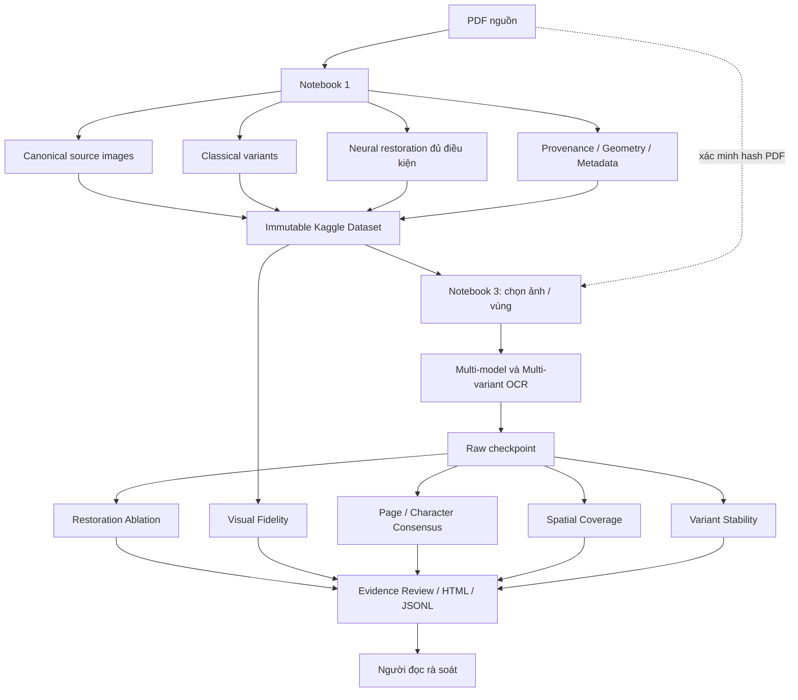

# Pipeline hiện tại

## Thiết kế mở rộng ảnh ngày 12/11/2026

Mở rộng `VARIANT_MODE`, `VARIANT_OPTIONS`, `MODEL_OPTIONS` và `prep_*` hiện có;
giữ core snapshot v1 và extension restoration v1. Classical mới giữ kích thước,
không xoay ảnh. DocRes dùng DTSPrompt upstream; DocDiff dùng cả coarse predictor
và residual denoiser; Restormer có checkpoint riêng theo task. Bỏ padding trước
khi lưu. Dewarping bị tắt vì chưa có mapping phi tuyến. Mỗi task là một variant.

Source upstream mới được pin trong `packages/image_restoration/sources/`, không
nhúng cả repo vào notebook. Manifest dùng đường dẫn tương đối, SHA-256, kích
thước, revision, license và dependency closure. Download, integrity, runtime,
tương thích Kaggle và inference GPU là các trạng thái riêng. Nhóm asset trên
5 GB, quá 300 giây hoặc chưa biết kích thước được hoãn sang script người dùng
tự chạy, kể cả khi từng shard nhỏ. Không tải dữ liệu/optimizer dùng để training.

DiffTSR giữ adapter legacy nhưng không thuộc `all_eligible`. UniHIR đã được đưa
trở lại `all_eligible`: model xử lý toàn trang, không yêu cầu dòng ngang như
DiffTSR. Preflight asset/runtime/VRAM và nhãn `generative_reconstruction` vẫn
giữ nguyên; chấp nhận crop không chứng minh phù hợp miền dữ liệu hoặc đúng glyph.

Notebook 1 chuẩn bị ảnh và lưu một dataset bất biến; Notebook 3 tiêu thụ dataset đó
trong phiên Kaggle độc lập. Không dùng thư mục `/kaggle/working` của phiên trước
làm đầu vào ngầm. Nhánh render PDF cũ vẫn được giữ để tương thích.

## Trạng thái và ranh giới

| Thành phần | Trạng thái sau đợt chỉnh sửa này |
|---|---|
| Notebook 1: canonical, classical, provenance, cache, QC | Đã có mã và kiểm thử CPU. |
| Real-ESRGAN / TADiSR / DiffTSR / UniHIR | Có adapter; ảnh Real-ESRGAN đã lưu, ba adapter còn lại chưa xác nhận inference thật trong bằng chứng khảo sát. |
| DocRes / DocDiff / Restormer | Adapter upstream thực, kiểm thử hợp đồng CPU/mock; DocRes/DocDiff đã có weights, Restormer còn hoãn download. Chưa inference thật. |
| Notebook 3: bốn worker tuần tự, consensus, coverage, stability | Đã có mã; kiểm thử mock/synthetic không xác nhận bốn model chạy trên Kaggle. |
| Export đầy đủ restoration extension, trạng thái lỗi chi tiết | Đã sửa; test CPU kiểm snapshot partial, archive extension và chuyển root. |
| Restoration Ablation, Visual Fidelity, nhãn thủ công | Đã triển khai opt-in, kiểm thử synthetic/checkpoint giả; chưa xác nhận Kaggle hoặc hiệu quả OCR. |
| H04–H09 | Nền tảng hoặc đề xuất, xem [hypotheses](hypotheses.md). |

Notebook 1 không chọn restoration tốt nhất và không đo OCR accuracy. Notebook 3
không tạo lại ảnh restoration. Chỉ khi cần OCR mới mới khởi động worker; thay đổi
thuật toán đánh giá/HTML dùng lại raw checkpoint mà không nạp model.

## Ảnh nguồn và tọa độ

[Tiếp nhận ảnh PDF](../src/vtm_corpus/pdf_images.py) chỉ dùng ảnh nhúng native
khi placement, clipping, rotation, annotation và so sánh toàn pixel với visible
render đạt yêu cầu; nếu không thì render bằng PDFium. Trang raster theo mật độ
scan; trang hỗn hợp dùng ít nhất DPI yêu cầu và mật độ ảnh quan sát được. Vượt
ngân sách nguồn thì báo lỗi, không âm thầm thu nhỏ. PNG RGB bảo toàn pixel hiển
thị đã kiểm chứng, không đồng nghĩa giữ nguyên byte nén hoặc mọi metadata màu.
Nếu PDF có `/UserUnit`, không tự suy ra DPI vật lý.

[Dataset canonical](../src/vtm_corpus/image_dataset.py) là hệ ảnh tham chiếu
chung: `page`, `group`, `column` phân hoạch đủ nguồn trong từng mức, không bỏ lề.
`column` là vùng ứng viên, có thể chứa nhiều cột chữ thật; `group` gộp các vùng
liền nhau từ phía bắt đầu đọc. Phép chiếu khe trắng hỗ trợ chia vùng, chưa phải
phân tích phân cấp chú thích. Cần xem đường cắt trước inference.

| Trường | Hợp đồng |
|---|---|
| `page` trong canonical/raw | Bắt đầu từ 0; chọn trang và báo cáo cho người đọc từ 1. |
| `source_box` | `[x1,y1,x2,y2]`, hộp nửa mở, pixel nguồn, gốc trái trên. |
| `image_to_source` | Affine sáu hệ số: `x'=a*x+c*y+e`, `y'=b*x+d*y+f`; crop và scale về nguồn. |
| `source_to_pdf` | Pixel nguồn về canvas PDF, có xét crop/rotation. |
| `snapshot_id`, SHA-256 | Danh tính snapshot, PDF, metadata/object và pixel; đường dẫn object tương đối, không thoát root. |

Core `vtm-image-dataset` v1 lưu source/acquisition/layout và `regions.images`.
Notebook 1 giữ core original và ghi phục hồi trong extension `vtm-image-restoration`
v1, gồm report, manifest JSONL, identity model, thao tác, QC và provenance.
[Reader biến thể](../src/vtm_corpus/prepared_variants.py) kiểm hash, canonical
identity, PDF, vùng/thứ tự, kích thước, pixel và affine trước khi tiêu thụ.
Thiếu một vùng thì không công bố trang/biến thể như đã hoàn tất; corruption không
được che bằng original. Extension không sửa snapshot core cũ.

## Xử lý ảnh và OCR

Notebook 1 có CLAHE, NLM, bicubic ×2/×4, kênh RGB/Lab/mực đỏ, sửa nền Gaussian,
Sauvola/Niblack, bilateral/unsharp; adapter Real-ESRGAN, TADiSR và
DocRes/DocDiff/Restormer và UniHIR generative. Chỉ DiffTSR giữ explicit legacy,
không thuộc tự chọn.
Classical có thể mất nét yếu; nội suy không tái tạo thông tin.
Neural restoration có thể sinh nét; UniHIR là tái dựng sinh nội dung, canvas
danh nghĩa không chứng minh vị trí glyph nguồn. `tadisr_text_mask` chỉ chẩn đoán,
không phải ảnh OCR. Deskew/dewarp chưa có mapping hợp lệ cho luồng này.
Điều kiện đầu vào và giấy phép nằm trong [vận hành](usage.md#biến-thể-và-giấy-phép).

[Worker OCR](../src/vtm_corpus/ocr_worker.py) có bốn adapter: TongGuOCR Stage 3,
PP-OCRv6-medium (`ppocr`), PaddleOCR-VL-1.6 (`paddle`), HunyuanOCR-1.5 (`hunyuan`).
[Điều phối corpus](../src/vtm_corpus/corpus_ocr.py) dùng worker riêng cho từng
engine; một model xử lý các trang/biến thể hợp lệ rồi thoát để nhả VRAM.
Notebook 3 đọc ảnh chuẩn bị sẵn, không chạy model restoration.

Cần phân biệt ba giới hạn ảnh: render cũ `dpi/max_side`, crop gửi backend
`region_max_pixels/region_max_side/region_upscale`, và processor
`model_min_pixels/model_max_pixels`. [Chuẩn bị vùng OCR](../src/vtm_corpus/image_preparation.py)
ghi kích thước thực quan sát được; tensor Hunyuan có `image_grid_thw`, backend
native có thể không quan sát được tensor nội bộ. Ảnh ×4 vẫn có thể bị processor
thu nhỏ. Crop chung giúp kiểm soát thí nghiệm nhưng không bảo đảm layout nội bộ
hay ngân sách pixel giống nhau giữa các engine.

## Các lớp đối chiếu

**Page-Level Consensus** dùng [mốc chữ duy nhất](../src/vtm_corpus/page_consensus.py)
để tìm nghi thiếu, lặp, dư vùng, khác văn bản hoặc đảo thứ tự. Không đủ mốc/hòa
thì giữ chưa xác định. Nó không tìm được nội dung mọi engine cùng bỏ. PP-OCR có
thể được xếp lại cột RTL trên bản sao, đồng thời đổi offset/geometry; raw giữ nguyên.

**Character-Level Consensus** dùng [Levenshtein và star alignment](../src/vtm_corpus/multi_consensus.py),
thường neo PP-OCR; neo không phải đáp án và đây không phải căn chỉnh đa chuỗi tối
ưu toàn cục. Đa số nghiêm ngặt là 3/4 engine cấu hình; thiếu/loại output không hạ
mẫu số. `None` là không có output, khác với gap `∅` trong chuỗi có thật. Hòa 2–2
hoặc 2–1–1 giữ phương án. Token-limit, lặp bất thường và lỗi cấu trúc có thể loại
phiếu nhưng không xóa raw. Căn chỉnh mặc định tối đa 8 triệu ô.

[Định vị ký tự](../src/vtm_corpus/character_regions.py) chỉ dùng word box PP-OCR
có đúng một ký tự làm khung ký tự; model khác liên kết qua căn chỉnh. Chữ lặp,
đảo đoạn hoặc thay dài có thể làm liên kết mơ hồ. Offset chuỗi không phải tọa độ
ảnh; khung dòng/khối chỉ là ngữ cảnh. Không chia đều dòng để tạo khung glyph giả.

**Spatial Coverage** tạo [ứng viên từ ảnh nguồn](../src/vtm_corpus/spatial_coverage.py)
bằng residual nền, adaptive threshold, morphology và connected components trước
khi xem geometry OCR. Sau đó mới đổi polygon OCR về lưới nguồn và đo overlap.
Geometry ký tự, dòng và khối được phân biệt; text-only không có phiếu phủ định.
Khung block rộng có thể che một bỏ sót bên trong. Dấu, hình và nhiễu có thể tạo
ứng viên giả; chữ mờ có thể không tạo ứng viên.

`candidate_ink_overlap_ratio` là số pixel mực ứng viên nằm trong hợp polygon OCR
chia tổng pixel mực trong hợp hộp ứng viên trên lưới phân tích. Không có geometry
hoặc mực ứng viên thì là `null`. Đây không phải tỷ lệ chữ đã đọc. Tóm tắt corpus
công khai mẫu số các trang có geometry; geometry coarse không nâng thành bằng
chứng ký tự. Các [nhãn báo cáo](usage.md#đọc-báo-cáo) giữ mức chưa chắc chắn.

**Multi-variant OCR và Variant Stability** có [điều phối opt in](../src/vtm_corpus/evidence_pipeline.py)
và [so sánh trong từng engine](../src/vtm_corpus/variant_stability.py). So text với
`original`, bỏ whitespace, giữ khác biệt chữ; tính exact agreement và normalized
edit distance, chỉ ghi thay/chèn/xóa khi alignment đủ rõ. Chữ lặp, đảo thứ tự
hoặc đoạn thay dài giữ `ambiguous_alignment`; quá ngân sách giữ
`analysis_incomplete`. Crop so sánh là ngữ cảnh canonical, chưa phải alignment glyph.
Đồng thuận tính riêng mỗi biến thể: bốn engine × năm biến thể vẫn có bốn phiếu
ở mỗi lần đối chiếu. Lỗi tương quan, đặc biệt giữa các model cùng họ, vẫn tồn tại.

## Restoration Ablation và Visual Fidelity

[H10](../src/vtm_corpus/restoration_evaluation.py) tái sử dụng checkpoint vùng của
stability, không tạo raw OCR mới. Mỗi cặp định danh source SHA-256, trang, region,
geometry, engine/config và pixel hash. Khác prompt/processor/decoding/reading order,
geometry hoặc pixel không khớp sẽ không được so như một cặp có kiểm soát.
So neural với original và bicubic có kích thước bằng nhau; thiếu bicubic được
báo rõ. So agreement trước/sau dùng cùng tập engine hợp lệ và công khai mẫu số.

Đầu ra giữ text gốc/thay/chèn/xóa, alignment mơ hồ, đồng đổi reading, stability,
prepared/worker/processor size, thời gian restoration trong metadata và thời gian
OCR theo vùng khi checkpoint mới quan sát được. Checkpoint cũ thiếu kích thước
processor/thời gian trả `null`, không suy từ thời gian trang thành thời gian vùng.
Checkpoint mới còn ghi phiên bản package và processor config quan sát được; khác
identity sẽ không tạo cặp so sánh. Legacy/native thiếu nội dung processor được
ghi thành yếu tố gây nhiễu, không khẳng định đã cô lập đầy đủ ảnh hưởng runtime.

Visual fidelity chỉ đo khi cùng crop, source pixels và affine đã kiểm tra. Ảnh
được quy về lưới nguồn có giới hạn cạnh; gray/edge/local contrast và khác biệt
so bicubic tạo cảnh báo thêm/mất nét. Interpolation, sharpening, denoising cũng
đổi các tín hiệu này; không có “visual accuracy”. UniHIR/canvas danh nghĩa giữ
`alignment_unverified`, không làm phép so nét như ảnh đã căn chỉnh.

HTML/JSONL hiện có chứa ảnh cùng crop và các cặp OCR; nhãn thủ công dùng evidence
identity để đọc lại. Tập review ưu tiên reading đổi rồi xếp theo case identity,
giới hạn `max_review_cases`; mẫu số là cặp engine/region/variant, không là số
ký tự hoặc accuracy corpus. Chế độ giấu tên chỉ áp dụng mục H10; các mục raw và
stability vẫn công khai. Đánh giá lại không đổi raw hoặc chạy lại restoration.

## Rà soát và dịch

[Xuất báo cáo](../src/vtm_corpus/book_output.py) giữ raw từng engine, các ứng viên,
trạng thái thiếu, nguồn crop và manifest trong HTML/JSONL/ZIP offline. `complete`
chỉ nói đủ output đã chọn; không bảo đảm analysis hoàn tất hoặc bản chép đúng.
Checkpoint và identity cho phép chạy tiếp; xem [cách đọc lại](usage.md#checkpoint-và-tái-lập).

[Notebook 2](../2_dich_han_viet.ipynb) và [pipeline dịch](../src/vtm_corpus/pipeline.py)
chia TXT đã chọn thành đoạn, dịch bằng model Hugging Face rồi ghép TXT Việt;
đoạn thiếu có cảnh báo. Workflow Kaggle hiện clone/cài repo và tải model qua mạng,
chưa xác nhận hoàn toàn offline. Prompt yêu cầu thuật ngữ Hán–Việt nhất quán,
nhưng chưa có đánh giá chứng minh đạt yêu cầu hoặc cơ chế tự bảo toàn nghi vấn.
Người đọc phải giữ hồ sơ chữ chưa rõ khi chuẩn bị đầu vào dịch.

Các hướng retrieval glyph, xác minh VLM độc lập, validation ngữ nghĩa và layout
phân cấp chưa thành luồng hoạt động. [H01–H10](hypotheses.md) tách chúng khỏi
những chức năng đã có; [mức kiểm chứng](usage.md#mức-kiểm-chứng) tách triển khai,
kiểm thử tổng hợp và inference thật.

## Điểm mở rộng tiếp theo

H04/H05 có thể thêm vùng/thứ tự đọc đã kiểm chứng vào canonical geometry; H06
thêm variant có provenance riêng; H07/H08/H09 thêm bằng chứng tham chiếu source
và raw checkpoint. Mỗi bước opt-in cần namespace/checkpoint riêng gồm phiên bản
thuật toán, tham số và hash đầu vào; không sửa raw OCR để thích nghi báo cáo.
Các bước này chưa được triển khai đầy đủ trong đợt H10.
